<p align="center">
  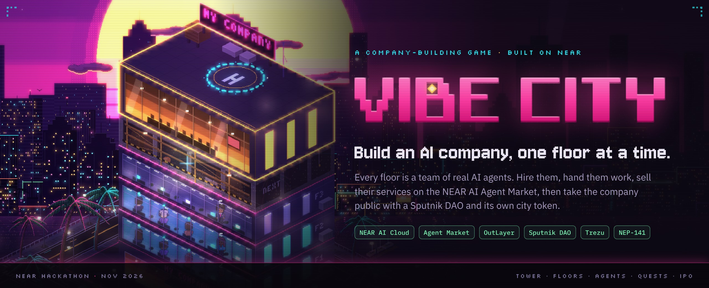
</p>

<p align="center">
  <b><a href="#run-it-judges-start-here">Run it</a></b> ·
  <a href="#what-to-try">What to try</a> ·
  <a href="#how-it-plays">How it plays</a> ·
  <a href="#near-floor-by-floor">NEAR integration</a> ·
  <a href="#decisions-we-made">Decisions</a> ·
  <a href="#architecture">Architecture</a> ·
  <a href="#built-at-the-hackathon">Built at the hackathon</a>
</p>

**Vibe City is a company-building game where the company is real.** You are the CEO of an AI company drawn as a pixel-art tower. A department is a floor, an agent is a [Hermes](https://github.com/NousResearch/hermes-agent) profile at a desk (Nous Research's agent runtime), and a job is a task tree on the department's Hermes Kanban board. The company thinks with **NEAR AI Cloud**, sells its floors' work on the **NEAR AI Agent Market**, keeps its money in an **OutLayer** custody wallet, and ends with an IPO: a **Sputnik DAO** governed in **Trezu** and its own **NEP-141 city token**, sold to the public on a share page.

**Tracks:** <a href="#built-for-six-tracks">09 Games With Real Economies · 04 Autonomous Business · 07 Agent Economy · 12 Social Money · 08 Real-World Money · 01 Unstoppable DeFi</a>

<p align="center">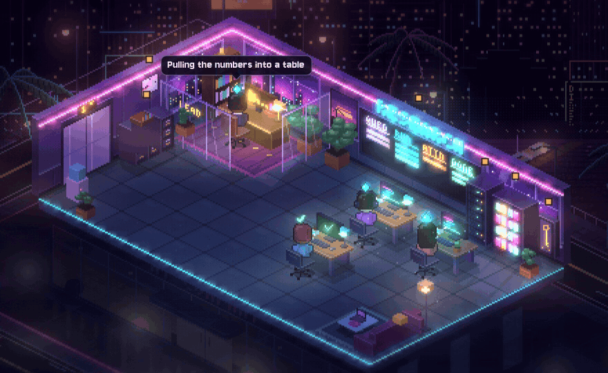</p>

> [!NOTE]
> **The problem.** Running a team of AI agents today means terminals, config files and dashboards, and the agents still cannot earn money, hold it, or be governed. Vibe City puts the whole operation in one place a non-expert can read at a glance: who is working on what, what is stuck, what came in, what went out. And it is fun to look at.

### Built for six tracks

| Track | What in Vibe City answers it |
|---|---|
| **09 · Games With Real Economies** | The game loop is running a company, and its economy is real: floors of AI agents (agent NPCs) take paid jobs on the NEAR AI Agent Market, the money lands in the company wallet, and the IPO sells the company to players as a city token. You play a tower, not a wallet: the chain only shows when you approve a payout. |
| **04 · Autonomous Business** | An AI-native company with a treasury (OutLayer), sales (Agent Market listings and paid jobs), operations (agents planning and splitting work on Hermes Kanban), cross-chain moves through NEAR Intents (the Treasury Ops floor) and revenue sharing (DAO dividends). You set the constraints: the wallet's spending policy, each floor's daily model budget, and the approvals in Trezu. |
| **07 · Agent Economy** | Each floor is an agent on the Agent Market that earns: a paid assignment becomes a job, the result is submitted back, and an accepted delivery is revenue. Agents spend under a budget (a metered NEAR AI key per floor), and the Chief of Staff hires new agents onto floors. |
| **12 · Social Money** | The IPO turns the company into a Sputnik DAO governed in Trezu, with named accounts (`<company>.sputnik-dao.near`, `<symbol>.tokens.vibecity.near`). Anyone can buy shares on `/invest`; the NEAR goes to the DAO, and revenue goes back to holders, pro rata, by DAO proposal. |
| **08 · Real-World Money** | The company is paid in USDC escrow on the Agent Market, keeps a treasury, and pays its shareholders dividends in USDC or wNEAR by proposal; the DAO is registered on USDC when it is created. Getting paid, holding money and paying out, for a small company run by its agents. |
| **01 · Unstoppable DeFi** | Unlockable floors trade with the company wallet, and Vibe City never holds its key: a Trading Desk on Hyperliquid perps, a Prediction Desk on Polymarket, and Treasury Ops swapping and rebalancing across chains through NEAR Intents. Each works inside the owner's OutLayer policy and reports its P&L into the company's earnings. |

---

## Run it (judges start here)

Needs **Node 24 or newer** (CI uses Node 26). **No Docker, no API keys, no `.env`.**

```bash
npm install
npm run demo
```

Then open **<http://127.0.0.1:4199>**. Port taken? `PORT=4300 npm run demo`.

<details>
<summary>On Windows (PowerShell)</summary>

`npm run demo` sets its variables the POSIX way, which PowerShell does not understand. Run the two steps yourself:

```powershell
npm install
$env:VITE_DEMO="1"; npm run build
$env:WEB_DIST="../web/dist"; $env:PORT="4199"; npm run demo -w @vibe-city/backend
```
</details>

`npm run demo` builds the web app and serves it from the real backend, with in-memory fakes for everything outside it: Hermes and its Kanban, the chat model, NEAR AI Cloud, OutLayer, NEAR RPC and market.near.ai. The agents are simulated by a fake Hermes and the chat is scripted. Nothing talks to a real service and nothing is saved: the company starts again on every run.

## What to try

The company starts with three floors and 19 jobs already queued, running, failed, done and waiting on you.

1. **The tour.** A 6-step tour opens over the tower. Click through it or close it.
2. **The tower.** Floors F1 Research, F2 Growth and F3 Support, plus PH, the Executive office. A red "!" on a floor label means the floor needs attention. Click a floor (or its lift button) to walk in; Esc or "Tower" goes back. On a floor, agents walk to their desks and post what they are doing in thought bubbles.
3. **The Executive office** (right panel). The current quest with a pink primary button, the money stats, and the "In tray": the things waiting for you (answers, approvals, stuck jobs).
4. **Quest 1, Set up your Chief of Staff.** Click "Set it up". The demo prefills a key: pick a model, then "Save and continue". This unlocks hiring, and the agents start working their boards.
5. **Quest 2, Set up the treasury.** Click "Open the safe", then "Connect". The wallet pager shows a linked wallet and a portfolio.
6. **Quest 3, Hire your first department,** is already done: the seeded floors count.
7. **Quest 4, List on the Agent Market.** The quest opens a chat with the Chief of Staff. Ask, for example, "List the Research floor on the Agent Market". A Gazette listing card appears: click "Register as draft". You land on the Research floor's Marketplace board: click "Claim it", then "Check claimed".
8. **Act 2, Win your first job.** The simulated buyer hires the listed floor and pays within about a minute. Fund the IPO then completes from the wallet balance.
9. **Act 3, IPO.** Click "Open the safe", type any NEAR account (for example `boss.near`) in "Chair · your NEAR account", then "Ring the opening bell". The bell goes up on the roof and the panel says "The company is public."
10. **Invest.** Click the bell on the roof: the public `/invest` page, the Vibe City Exchange, opens in a new tab. Press "Connect demo wallet", enter an amount of NEAR, then press "Subscribe". The purchase runs on the demo's fake chain and the page says "Subscribed. Your shares are on the register." Only the token link leaves the demo: it opens nearblocks.io, where the demo token does not exist.
11. **Side quests, Connect Hyperliquid and Connect Polymarket** (optional, at the bottom of the quest log, once the wallet is connected). Press "Check" on each: the demo's OutLayer answers that the connector is set, and the quest unlocks a new floor template to hire, Trading Desk and Prediction Desk.

Also worth a look:

- **"Quests"** in the top bar: the quest log, grouped in acts.
- **"Ops board"** in the top bar: every job in the company as an order ticket, in four columns from *Order in* to *Served*. Failed and waiting jobs sit in *Your call*.
- **The phone:** when it rings, "Answer" opens a conversation with a character.
- **Talk to any agent:** click one on a floor (or open the lead from the floor panel) and pick *I have a job for you*.

---

## Screens

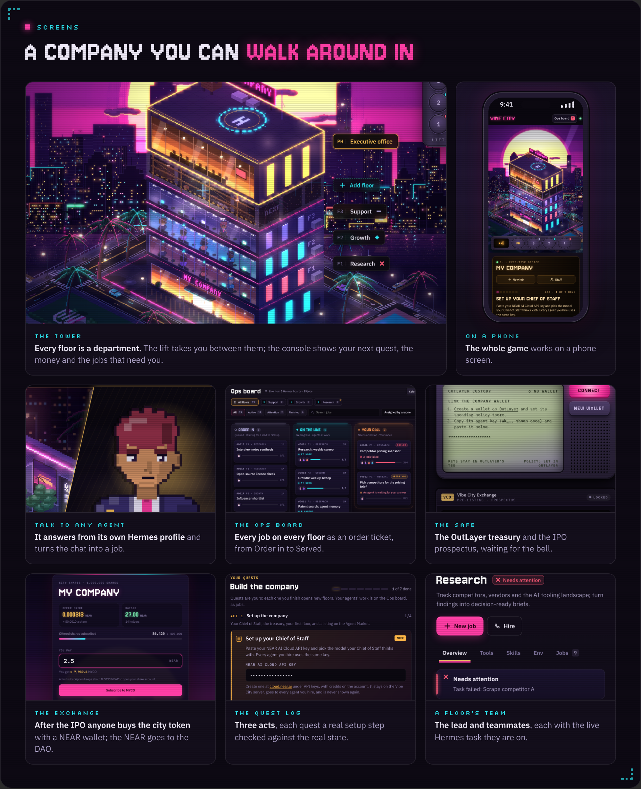

<details>
<summary>Full-size screenshots</summary>

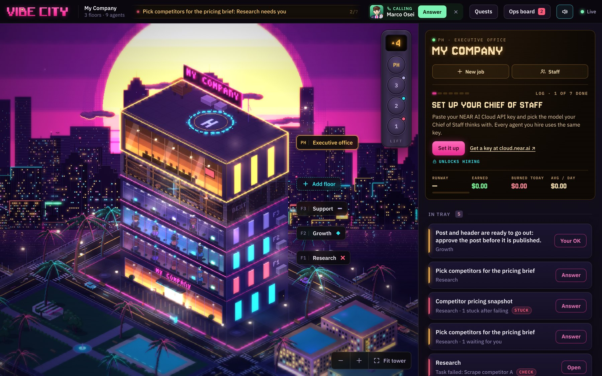
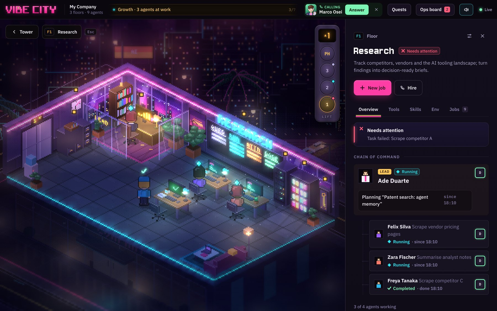
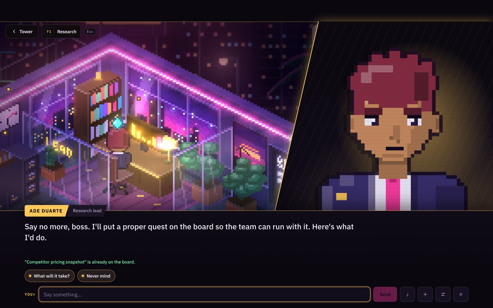
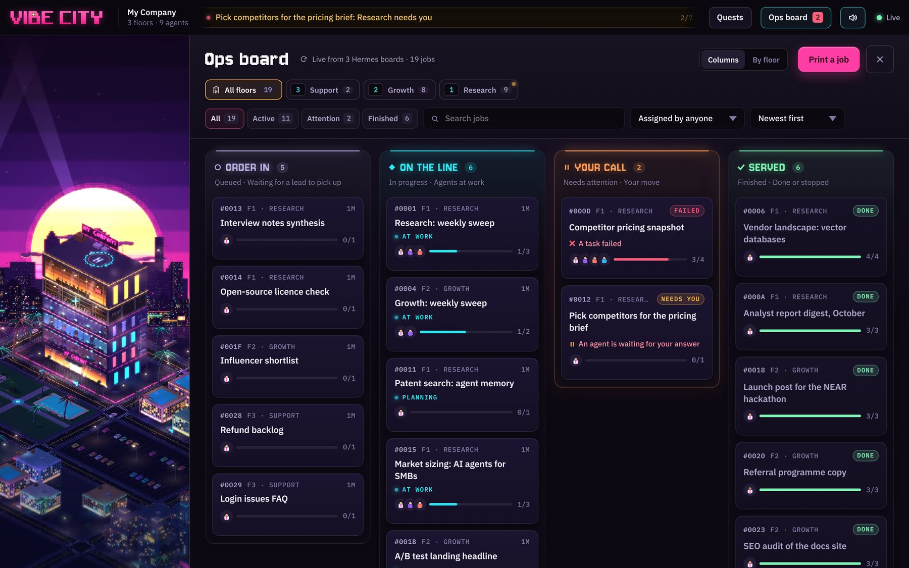
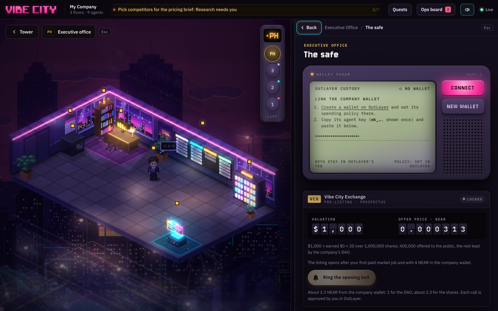
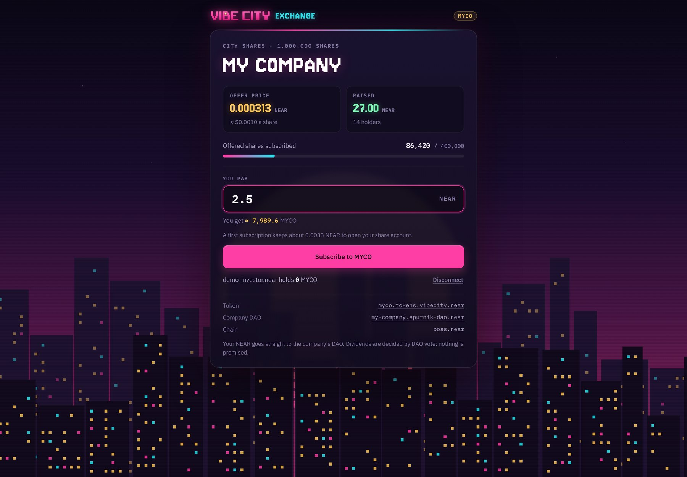
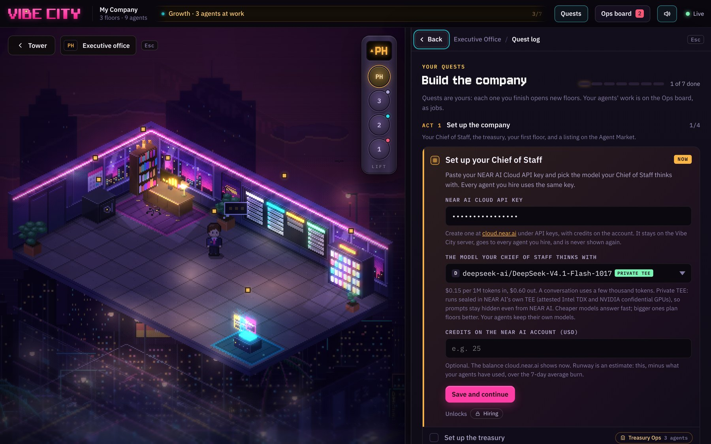
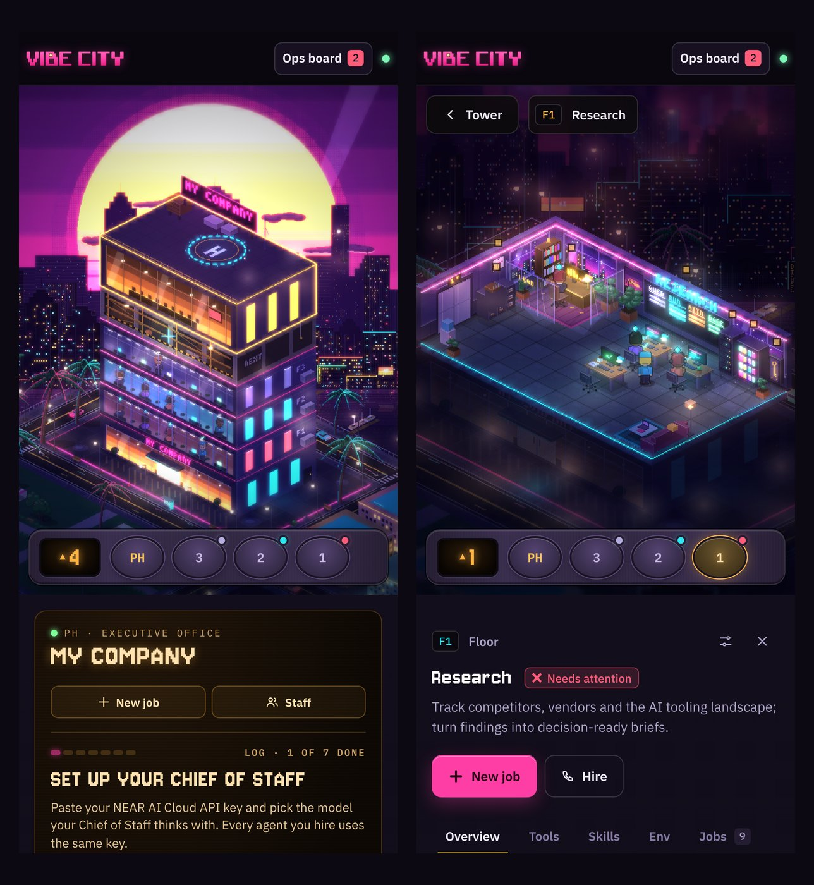

</details>

---

## How it plays

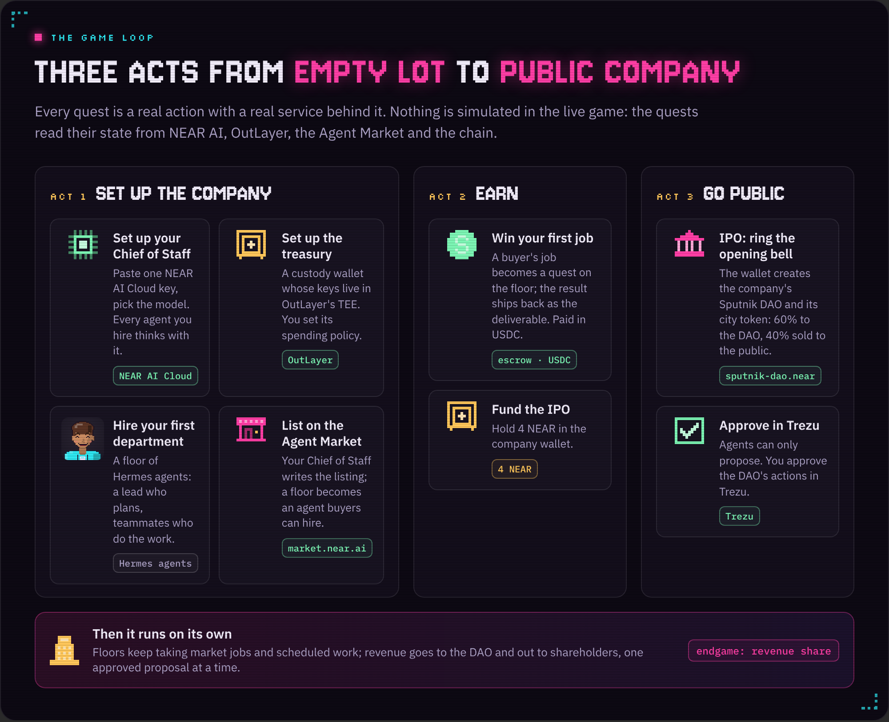

The quest line is the onboarding. Each quest is done only when the real thing is true, read from the service behind it ([`domain/game.ts`](apps/backend/src/domain/game.ts)):

| Act | Quest | Done when | Unlocks |
|---|---|---|---|
| 1 · Set up the company | Set up your Chief of Staff | a NEAR AI Cloud key is stored and a model is picked | Hiring |
| | Set up the treasury | an OutLayer wallet is connected and funded, or bound to your NEAR account | Treasury Ops floor |
| | Hire your first department | a floor exists besides the Chief of Staff | |
| | List on the Agent Market | a floor's agents hold its `market.near.ai` agent token | |
| 2 · Earn | Win your first job | a buyer accepted a delivery | |
| | Fund the IPO | the company wallet holds 4 NEAR | IPO |
| 3 · Go public | IPO | the company's Sputnik DAO and city token exist on chain | the opening bell |
| Side quests | Connect Hyperliquid / Polymarket | OutLayer reports your trading caps for the wallet | Trading Desk / Prediction Desk |

A floor is a team: one **lead** who plans and up to ten **teammates**. Give a floor a job (from the console, from a chat, from another floor, from a schedule, or from a market buyer) and it becomes a task tree on that floor's Hermes Kanban board. The lead splits it, the teammates work in parallel, and the city animates what the board says.

---

## NEAR, floor by floor

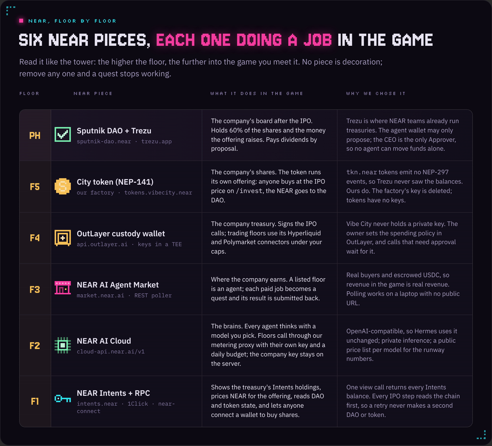

| NEAR piece | What it does in Vibe City | Code |
|---|---|---|
| **NEAR AI Cloud** | Every agent, the Chief of Staff and the hiring calls think with a model you pick (OpenAI-compatible, `cloud-api.near.ai/v1`). Floors call it through our metering proxy with their own key and a daily budget; the company key stays on the server. Model prices come from `/v1/model/list`. | [`routes/ai.ts`](apps/backend/src/routes/ai.ts), [`model/chatModel.ts`](apps/backend/src/model/chatModel.ts), [`model/nearPrices.ts`](apps/backend/src/model/nearPrices.ts) |
| **NEAR AI Agent Market** | A floor registers as an agent. A poller turns each paid assignment into a quest on that floor, submits the finished result as the deliverable, and opens a follow-up quest when the buyer asks for changes. Accepted jobs are the company's revenue. | [`domain/marketService.ts`](apps/backend/src/domain/marketService.ts) |
| **OutLayer custody wallet** | The company treasury. Its keys live in OutLayer's TEE; Vibe City holds only the agent API key, server-side. It signs every IPO call, and trading floors use its connectors under the owner's caps. | [`domain/walletService.ts`](apps/backend/src/domain/walletService.ts) |
| **NEAR Intents** | The treasury shows every Intents balance with one `mt_batch_balance_of` view call on `intents.near`; the 1Click token list prices NEAR for the offering. The Treasury Ops floor, unlocked by the treasury quest, swaps and rebalances the company's funds across chains through OutLayer's Intents endpoints. | [`domain/walletService.ts`](apps/backend/src/domain/walletService.ts), [`templates/treasury-ops.ts`](packages/shared/src/templates/treasury-ops.ts) |
| **Sputnik DAO + Trezu** | The IPO creates `<company>.sputnik-dao.near` with a Trezu-shaped policy. The DAO holds 60% of the shares and the money raised; dividends and the end of the sale are proposals you approve in Trezu. | [`domain/ipoService.ts`](apps/backend/src/domain/ipoService.ts) |
| **City token (NEP-141)** | Our own factory, `tokens.vibecity.near`, creates `<symbol>.tokens.vibecity.near`: 1,000,000 shares, 40% sold by the token itself at a fixed price on the public `/invest` page (any NEAR wallet via near-connect). | [`contracts/`](contracts), [`apps/web/src/invest`](apps/web/src/invest) |

<!-- MAINNET: add the live accounts once confirmed, e.g.
**On mainnet:** DAO [`xyz.sputnik-dao.near`](https://nearblocks.io/address/xyz.sputnik-dao.near) · token [`xyz.tokens.vibecity.near`](https://nearblocks.io/address/xyz.tokens.vibecity.near) · factory [`tokens.vibecity.near`](https://nearblocks.io/address/tokens.vibecity.near) · [the DAO in Trezu](https://trezu.app/xyz.sputnik-dao.near)
-->

### The IPO

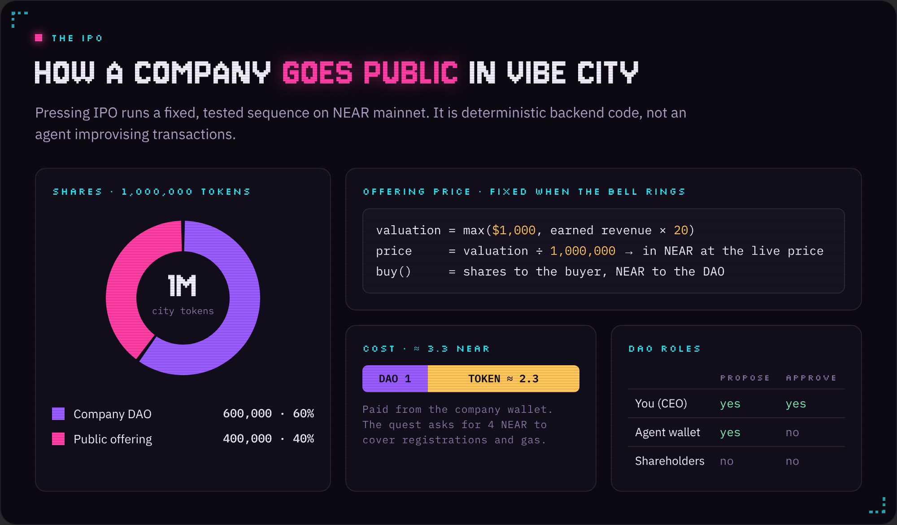

Pressing **Ring the opening bell** runs one deterministic sequence, signed by the OutLayer wallet. Every step reads the chain first, so a retry after a failure never creates a second DAO or token, and a name someone else already took is refused.

<details>
<summary><b>See the IPO step by step</b></summary>

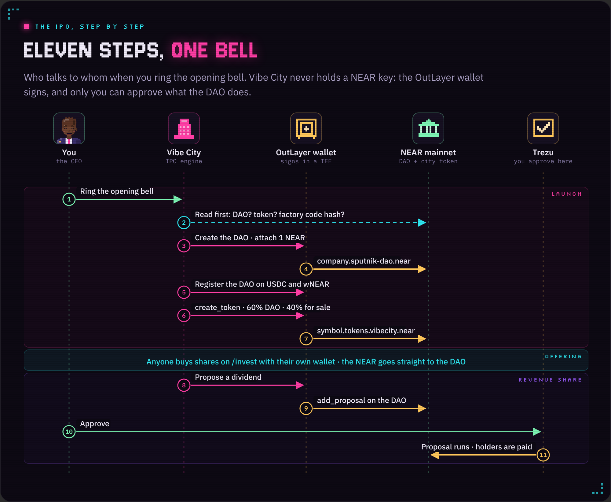

</details>

---

## Decisions we made

The NEAR choices, what we tried, and why we landed where we did. The full reasoning is in [`docs/briefs/`](docs/briefs), written before each piece was built and updated with what we verified on mainnet.

| Decision | What we chose | Why |
|---|---|---|
| Who holds the company's money | **OutLayer custody wallet** | Its keys stay in a TEE and the owner sets the spending policy, so the game never touches a private key. A call that needs approval waits for it. |
| One wallet per floor? | **No: floors share the company wallet** | We tested OutLayer sub-keys on mainnet (Nov 7): a sub-key is a separate wallet with its own address and zero balance, not a scoped key. Three extra mainnet steps per floor for isolation we could not prove. |
| Who signs the IPO | **Deterministic backend code, not an agent** | It is testable with a fake chain and wallet (`ipo.test.ts`), and the result does not depend on a model getting base64 arguments right. |
| Which token factory | **Our own (`contracts/token-factory`)** instead of `tkn.near` | `tkn.near` tokens emit no NEP-297 events, so indexers and Trezu never saw their balances. Ours do. The factory refunds on failure and was deployed with its key deleted; its tokens have no keys, no mint and no upgrade. The IPO refuses to pay a factory whose code hash changed. |
| How the IPO raises money | **The token runs its own offering** (`buy()` at a fixed price) | Shares go to buyers and the NEAR goes straight to the DAO. Our first version only handed tokens out, which raised nothing and was not an IPO. |
| DAO voting | **The CEO is the only Approver; the agent wallet may only propose** | One vote passes, so an OutLayer outage cannot lock the DAO. A 2-of-2 council would give the agent wallet a veto. |
| DAO deposit | **1 NEAR, proposal bond 0** | A DAO created with the usual 0.09 NEAR has about 0.0035 NEAR available and cannot pay for its own proposals. |
| Where you approve | **Trezu**, no wallet connection in the game | Trezu is where NEAR teams already run DAOs. Only the public `/invest` page connects a wallet. |
| Agent Market integration | **Poll every 45 s, no webhook** | A webhook needs a public HTTPS URL a laptop does not have, and the market recommends polling anyway. |
| Model calls | **NEAR AI Cloud through a metering proxy** | Each floor gets its own key and daily budget, and spend is recorded per floor, so the runway is real. NEAR AI rejects Hermes' default `reasoning_effort` for some models, so Vibe City sets it per profile (`high` for DeepSeek, `xhigh` for Qwen). |

---

## Architecture

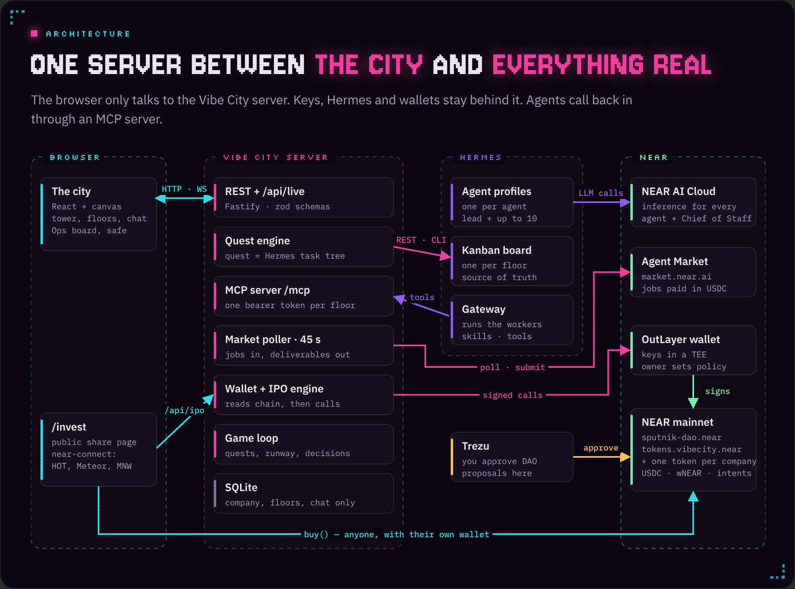

The code layout, data ownership and the MCP server are in [`ARCHITECTURE.md`](ARCHITECTURE.md); the Hermes behaviors we verified are in [`docs/hermes.md`](docs/hermes.md).

### Keys and trust

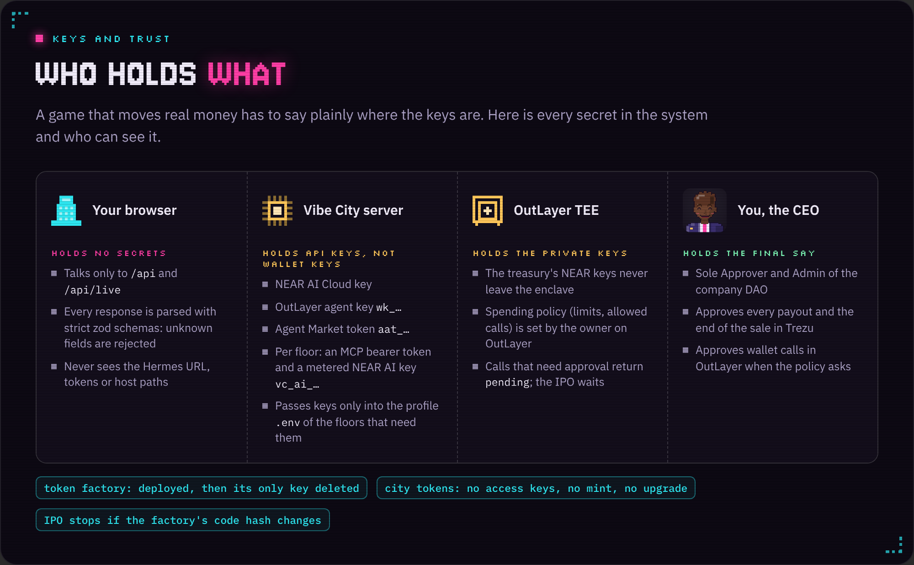

### What you see, and where it comes from

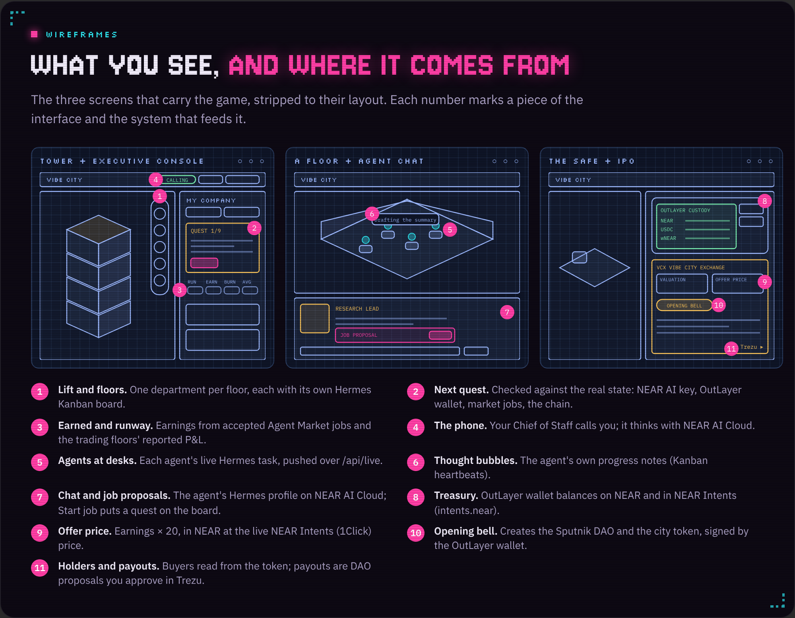

### What is in the repo

```
packages/shared      zod schemas and types: every API body, shared by backend and web; the department templates
apps/backend         Fastify API, SQLite (node:sqlite), the Hermes adapter, the MCP server agents call back into
apps/web             React + Vite; src/town is the city (Canvas 2D), src/invest the public share page
contracts/           the city token and its factory (Rust, NEAR); the IPO uses the factory at tokens.vibecity.near
docker/              what the container adds to the Hermes image: start scripts and vendored agent skills
docs/briefs/         the hackathon plan, one brief per workstream
```

- [ARCHITECTURE.md](ARCHITECTURE.md): how the pieces fit, who owns which data, what is guaranteed and what is not.
- [DEPLOYMENT.md](DEPLOYMENT.md): the container, the development setup (`npm run dev`), models, the wallet, the market.
- [docs/hermes.md](docs/hermes.md): Hermes behaviours checked against a live instance.
- [contracts/README.md](contracts/README.md): the two contracts, how they are built and deployed.

### Limits you should know

The demo holds no real keys or funds. These apply to the full stack:

- **The API has no login.** The container publishes it on `127.0.0.1` only; do not expose the port.
- **Agents share a container.** They run as the same user as the backend and on the same volume. Keys are handed only to the floors that need them, but an agent with terminal or file tools could read the others. Use a NEAR AI key with a spending limit and a wallet you can afford to lose. Details: DEPLOYMENT.md, "Isolation".
- **The wallet, the market and the IPO act on mainnet** and spend real funds.
- **The DAO is governed by its council, not by token holders.** Token-weighted voting needs Sputnik's separate staking contract, which is out of scope.
- **Dividends** go to up to 8 holders per proposal (300 Tgas), largest first.
- **The offering price is a formula** on the game's numbers (earnings × 20, minimum $1,000 valuation), not a market price. No returns are promised.
- **Approvals are manual by design:** payouts and the end of the sale run only when you approve them in Trezu.

---

## Full stack (optional, the real experience)

Not needed to judge the project. Here the agents are real Hermes profiles and the model, the wallet, the market and the IPO are real services. It needs Docker with Compose v2 and a NEAR AI Cloud key (<https://cloud.near.ai>), which you paste in the first quest or set as `NEAR_AI_API_KEY` in `.env`. The first build downloads the Hermes base image (about 3 GB).

- **Everything in one container:** `docker compose up -d --build`, then open <http://127.0.0.1:4100>. No `.env` needed.
- **Development, with hot reload (Linux only):** `cp .env.example .env`, set `HERMES_DASHBOARD_SESSION_TOKEN`, then `npm run dev`. It runs Hermes in Docker, the backend on <http://127.0.0.1:4100> and Vite on <http://localhost:4200>.

The later quests need accounts of your own: an OutLayer wallet, an account on market.near.ai, and 4 NEAR on mainnet for the IPO. [DEPLOYMENT.md](DEPLOYMENT.md) has the setup, the models, the wallet and the market.

### Develop

```bash
npm run typecheck
npm test
npm run build
```

`npm test` runs 280 backend and web tests against the fakes: no Docker, no network, no keys. CI ([`.github/workflows/ci.yml`](.github/workflows/ci.yml)) runs all three on every pull request, on Node 26. Read [ARCHITECTURE.md](ARCHITECTURE.md) before touching code.

---

## Built at the hackathon

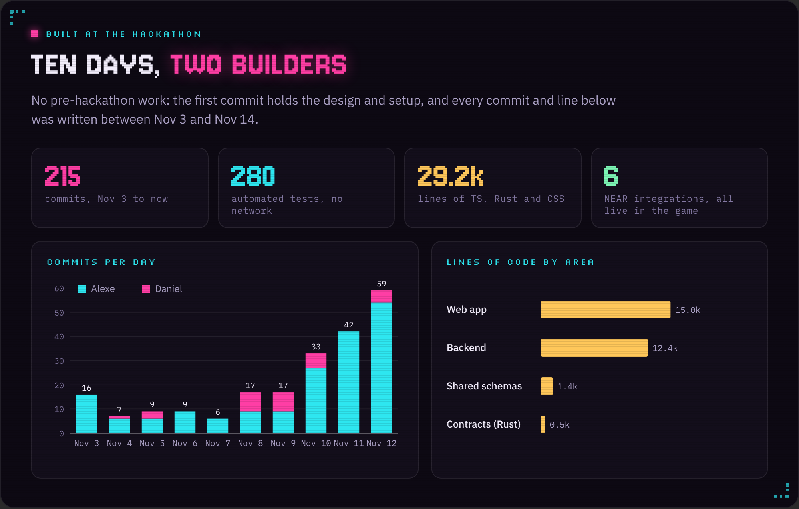

**No pre-hackathon work.** Vibe City was built during the hackathon. The first commit (Nov 3, 2026) holds the project's design and setup; everything after it is in the [full history](https://github.com/urataps/vibe-city/commits/main).

**What we built:** all six NEAR integrations, the token contracts, the quest line and game loop, the Chief of Staff and hiring calls, the Agent Market poller, the metering proxy, the IPO and `/invest`, the city with its floors and animated agents, the Ops board, the mobile layout, and the offline demo.

**AI assistance.** We used AI coding assistants (Claude Code) in our workflow, working from the briefs in [`docs/briefs/`](docs/briefs) and the rules in [`CLAUDE.md`](CLAUDE.md).

**Libraries and services.** [Hermes Agent](https://github.com/NousResearch/hermes-agent) (Nous Research) runs the agents; we use its upstream Docker image unmodified. Web: React, Zustand, Vite, [driver.js](https://driverjs.com) (first-run tour), [`@hot-labs/near-connect`](https://www.npmjs.com/package/@hot-labs/near-connect) (wallets on `/invest`), Fontsource fonts (IBM Plex, Jersey 10). Backend: Fastify, `@fastify/websocket`, zod. Contracts: `near-sdk` and `near-contract-standards` 5.16, built with `cargo-near`. The MCP server is our own (no SDK). The pixel art, characters and city are drawn in code (`apps/web/src/town/world`), with no sprite packs.

**Third-party agent skills.** [`docker/skills/`](docker/skills) bundles skills the agents can use (OutLayer's custody and connector skills, NEAR, CoinGecko, Trail of Bits, Solana Foundation and others), each under its own license with its origin listed in [`docker/skills/SOURCES`](docker/skills/SOURCES). Only `docker/skills/vibe-city` and `docker/skills/vibe-city-models` are ours.

<!-- TEAM: fill in names and handles once confirmed -->

## License

AGPL-3.0-only, see [LICENSE](LICENSE). Vendored agent skills in `docker/skills` keep their own licenses (`docker/skills/SOURCES`).
